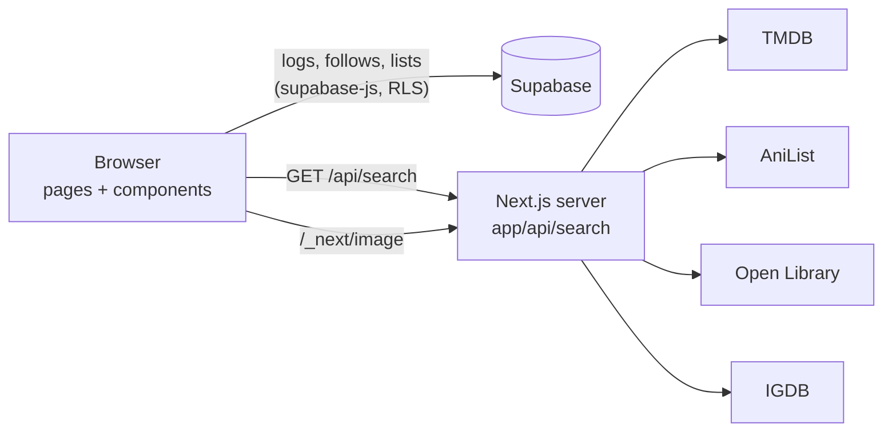

# Architecture

How Media Log is put together: what each folder is for, the two big ideas that shape the code, and one search
followed from the keyboard to the screen. For the "why" behind each piece, see the stage sections in `LEARNING.md`.

## The big picture

Two ideas explain most of the code:

1. **Interfaces with two backends.** Pages never talk to Supabase or localStorage directly. They call
   `getAuthService()` (`lib/auth`) and `getMediaStore()` (`lib/media`). With both Supabase variables set these return the
   Supabase versions; without them, the demo versions that save in localStorage. That's why the app runs with no
   setup at all, and why the logic can be tested without a database.
2. **One adapter per outside source.** TMDB, AniList, Open Library and IGDB answer in four different shapes. Each
   adapter (`lib/sources/<name>.ts`) converts its source's answer into ONE shared type, `MediaResult`. Everything after
   that (merging, logging, recommendations) only knows `MediaResult`.

Rule of thumb for where code goes: **logic in `lib/` (pure functions, tested), React in `components/`, URLs in `app/`.**

## Every folder

| Folder | What lives there |
|--------|------------------|
| `app/` | The App Router: each folder is a URL, each `page.tsx` is a page. `layout.tsx` wraps every page (demo strip, nav bar, `AuthProvider`). `globals.css` holds Tailwind. `not-found.tsx` is the 404 page, `icon.svg` the tab icon. |
| `app/api/search/` | `route.ts`: the only server endpoint, `GET /api/search?q=&type=`. Runs on the server so the TMDB and IGDB keys never reach the browser. |
| `app/search/`, `app/feed/`, `app/login/`, `app/signup/`, `app/onboarding/` | One page each: search, the feed of people you follow, log in, sign up, pick a username. |
| `app/u/[username]/` | A profile (`page.tsx`) and its `diary/`, `lists/` and `stats/` pages. `[username]` is a dynamic segment: `/u/demo_leo` gives `username = "demo_leo"`. |
| `app/media/[type]/[id]/` | The item page, e.g. `/media/anime/anilist-154587`. The server part only checks the address; the browser part loads the item. |
| `app/lists/[id]/` | One list, with drag-to-reorder for its owner. |
| `components/` | React components, mostly `"use client"` (they run in the browser): forms, nav bar, profile, diary, search, feed, list editor, stats, poster grid, `Poster` (covers through `next/image`), `AuthProvider` (who is logged in) and the `useProfileLogs` hook. |
| `lib/auth/` | The `AuthService` interface (`types.ts`), its demo (`mock.ts`) and Supabase (`supabase.ts`) versions, the switch between them (`index.ts`), and username/display-name rules (`validation.ts`). |
| `lib/media/` | Everything about logs. The `MediaStore` interface (`types.ts`) with demo and Supabase versions, and pure logic: log rules (`validation.ts`), progress math (`progress.ts`), diary grouping (`diary.ts`), item links (`links.ts`), feed and likes (`feed.ts`), list order (`reorder.ts`, `lists.ts`), genre tags (`tags.ts`), stats (`stats.ts`), recommendations and bridge picks (`recommend.ts`), display text (`display.ts`), allowed cover hosts (`covers.ts`). |
| `lib/sources/` | Search. The adapter contract (`types.ts`), one adapter per source, shared cleaning helpers and `fetchJson` (`shared.ts`), which version of each source to use (`setup.ts`, `server.ts`), the parallel search (`unified.ts`), merging and deduplication (`merge.ts`), caching (`cache.ts`), the samples as a recommendation catalog (`catalog.ts`). |
| `lib/sources/samples/` | Saved answers of each API. Used when a key is missing or offline, and by the tests (no live calls in tests). |
| `lib/demo/` | Demo mode only: the 3 labeled demo people and their logs (`seed.ts`), and the test that checks the Supabase seed file (`sql-seed.test.ts`). |
| `lib/supabase/` | The one shared Supabase client (`client.ts`). |
| `supabase/migrations/` | The database: tables, constraints and Row Level Security policies, as SQL to paste in filename order. |
| `supabase/seed/` | `demo-account.sql`: real logs for one demo account, run once by hand. |
| `docs/screenshots/` | The README screenshots. |
| `.github/workflows/media-log.yml` (repo root) | GitHub Actions: lint, tests and build on every push that touches this folder. |

Config files at the top: `next.config.ts` (image hosts and cache time), `eslint.config.mjs`, `tsconfig.json`
(the `@/` import shortcut), `vitest.config.mts` (tests = `lib/**/*.test.ts`), `postcss.config.mjs` (Tailwind),
`.env.example` (every variable, no values).

## One search, end to end

You type `dune` with the **All** chip on `/search` and press Enter.

1. **Browser: the page asks our server.** `components/MediaSearch.tsx` calls
   `fetch("/api/search?q=dune&type=all")`. It never calls TMDB itself (the key would be visible in DevTools).
2. **CDN and browser cache.** If the same URL was answered recently, the browser (1 minute) or Vercel's CDN (1 hour)
   answers straight away and steps 3 to 8 don't run (`Cache-Control`, see step 9).
3. **Server: the route handler.** `app/api/search/route.ts` reads `q` and `type` from the URL. `parseSearchFilter`
   (`lib/sources/types.ts`) turns anything unknown into `"all"`.
4. **Which sources, live or sample.** `getSourceEntries()` (`lib/sources/server.ts`, server-only) reads the keys from
   `process.env`, and `createSourceEntries()` (`setup.ts`) builds the list: TMDB and IGDB live if their keys are set,
   otherwise their samples; AniList and Open Library live, with their sample as a fallback. `MEDIA_LOG_USE_SAMPLES=1`
   forces samples everywhere. Every live source gets `withRevalidate(fetch)` (`cache.ts`).
5. **Ask all sources at once.** `unifiedSearch()` (`unified.ts`) keeps the sources that cover the chosen types (all
   four for "All"), sets a per-type limit (8 for "All", 20 for one type) and starts every search together with
   `Promise.all`. Each search is wrapped so it never throws: a failure becomes a status, or the sample's answer.
6. **Each adapter calls its API.** E.g. `tmdb.ts` builds `GET https://api.themoviedb.org/3/search/movie?query=dune` (and
   `/search/tv`), AniList POSTs one GraphQL query for anime and manga, Open Library GETs `search.json`, IGDB POSTs an
   Apicalypse query with a Twitch token (`createTwitchTokenProvider`, remembered in memory for ~60 days).
   `fetchJson()` (`shared.ts`) adds an 8-second timeout and turns HTTP errors into readable messages. Because of
   `next: { revalidate: 3600 }`, Next.js first looks in its **Data Cache**: the same request within the hour is
   answered without leaving our server.
7. **Convert to `MediaResult`.** Each adapter checks the answer (data from the internet can be anything), drops
   broken and adult entries, and converts each one: title, year, cover URL, creators, total episodes/chapters/pages,
   genres.
8. **Merge.** `mergeResults()` (`merge.ts`) interleaves the types (movie, book, game, ... instead of 8 movies first),
   merges duplicates (`isSameItem`: a shared title, ignoring case and accents, plus the same year, or a shared creator
   when a year is missing; e.g. TMDB's and AniList's *Spirited Away* become one anime, the anime copy wins) and puts exact title matches first.
9. **Answer.** The route returns `{ query, filter, results, sources }` as JSON. `sources` says, for each source, live,
   sample (and why) or error (and why). `searchCacheControl()` sets `public, max-age=60, s-maxage=3600,
   stale-while-revalidate=86400`, or `no-store` when a source failed, so a broken answer is never cached.
10. **Browser: show it.** `MediaSearch` shows the "Sample data" note from `sources`, then one card per result. Each
    cover goes through `Poster` → `next/image` → `/_next/image?url=...&w=...`, which resizes and converts it (only for the
    4 hosts in `lib/media/covers.ts`). If a cover fails, the title is shown instead.
11. **Logging it.** Pressing **Log it** opens `LogMediaForm`. On save, `getMediaStore().addLog()` runs
    `validateLogInput()` (`lib/media/validation.ts`), caches the item in `media_items` (only items someone logs are
    stored, never whole catalogs) and inserts the row in `logs`. In Supabase, Row Level Security checks that
    `user_id` is you.

## Where data lives

| Data | Demo mode | With Supabase |
|------|-----------|---------------|
| Accounts, profiles | localStorage `media-log:mock-db` | `auth.users` + `profiles` |
| Logs, items, follows, likes, lists | localStorage `media-log:mock-media` | `logs`, `media_items`, `follows`, `review_likes`, `lists`, `list_items` |
| Search answers | Next.js Data Cache (1 hour) + CDN | same |
| Resized covers | Next.js image cache (30 days) | same |
| Source keys | `.env.local` (server only) | Vercel environment variables (server only) |
