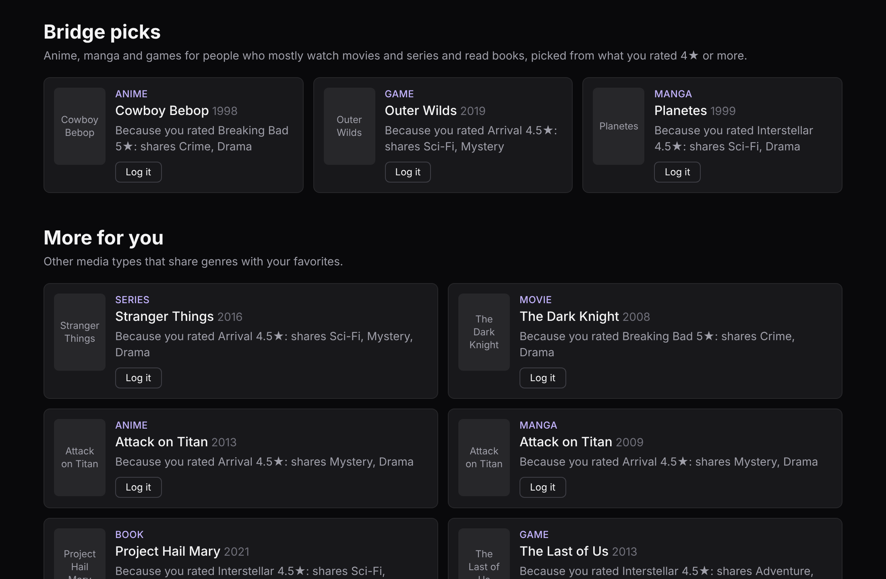
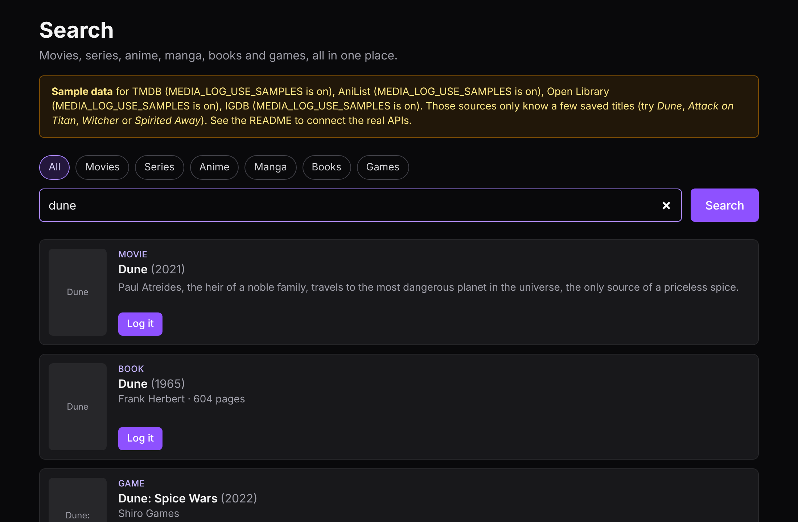
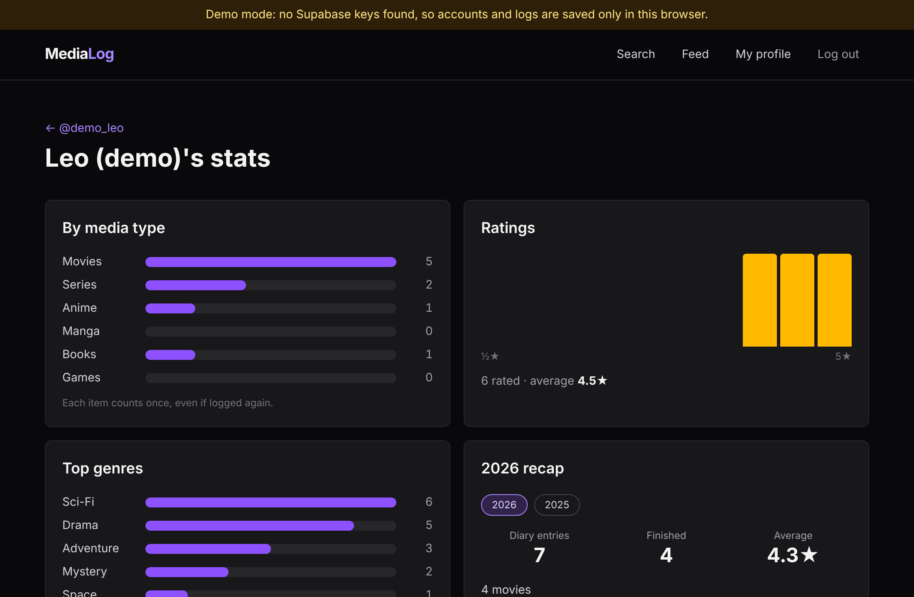
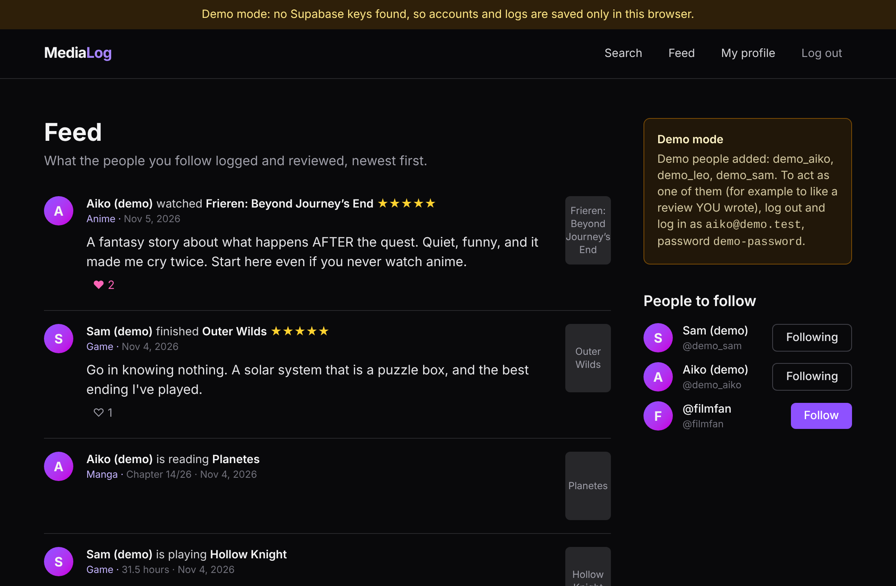
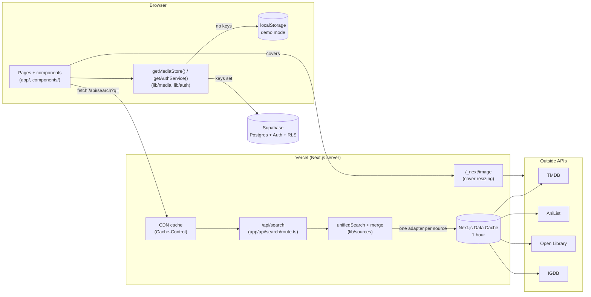

# Media Log

One place to log, rate and review everything you watch, read and play: movies, series, anime, manga,
books and games. Think Letterboxd, but for every kind of media, with one profile. See `PLAN.md` for
the full plan, `ARCHITECTURE.md` for how the code fits together, and `LEARNING.md` for what each stage taught.

**Status:** all 7 stages done. Runs fully in **demo mode** (no keys, data in your browser) and is ready to deploy on
Vercel with Supabase (see [Deploy to Vercel](#deploy-to-vercel)).

## The gap

Letterboxd is movies only. AniList and MyAnimeList are anime and manga only. Goodreads is books only. Backloggd is games
only. Nobody puts all of them in **one profile with one taste**, so nobody can tell you "you loved *Interstellar*, try the
manga *Planetes*". Media Log does, and uses it on purpose: its **bridge picks** show anime, manga and games to people who
mostly log movies, series and books, so niche media reaches people who only use mainstream apps.

## Features

- **One search for 6 media types:** TMDB (movies, series), AniList (anime, manga), Open Library (books) and IGDB (games),
  asked in parallel, merged into one list without duplicates (*Spirited Away* shows once, as an anime).
- **Logs:** status, half-star rating, review, "watched on" date, rewatch, and **progress** in the right unit (episode
  7/24, chapter 120/?, 45% of a book, 12.5 hours in a game).
- **Profile, diary, item pages:** a poster grid per type at `/u/<name>`, every log grouped by month in the diary, and an
  item page with everyone's average rating and reviews.
- **Social:** follow people, a feed of what they logged, likes on reviews, public or private **lists** with
  drag-to-reorder (and keyboard buttons).
- **Stats:** count per type, rating distribution, top genres, a yearly recap.
- **Bridge picks:** rule-based, explainable cross-media recommendations ("Because you rated Arrival 4.5★: shares
  Sci-Fi, Mystery"). No AI model.
- **Fast and cheap to run:** covers resized by `next/image`, source answers cached for an hour, search answers cached
  by Vercel's CDN.

## Screenshots

Taken in demo mode, logged in as the demo person Leo. Covers come from the sources' websites, which weren't
reachable when these were taken, so each cover shows its title instead (online, real posters appear).

| Bridge picks on the home page | One search, every media type |
|---|---|
|  |  |
| **Stats page** | **Feed** |
|  |  |

## Architecture



The browser talks to Supabase directly (Row Level Security decides what each user may read and write) and to our
server only for search, because TMDB and IGDB need secret keys. `ARCHITECTURE.md` explains every folder and follows one
search from the keyboard to the screen.

## Run it

```bash
cd apps/media-log
npm install
npm run dev        # open http://localhost:3000
```

With no `.env.local` the app runs in **demo mode**: a yellow strip says so, accounts, profiles and logs
are saved only in this browser's localStorage, and the Google button is disabled. Search uses small saved
**samples** for TMDB and IGDB until their keys are set, and for AniList and Open Library whenever they can't
be reached (the search page lists which sources use samples, and why). Everything else works.

## Commands (run inside `apps/media-log`)

| Command | What it does |
|---------|--------------|
| `npm run dev` | Start the app locally with live reload |
| `npm run lint` | Check the code with ESLint |
| `npm test` | Run the Vitest tests (logic in `lib/`) |
| `npm run build` | Production build (also type-checks everything) |
| `npm start` | Serve the production build |

GitHub Actions (`.github/workflows/media-log.yml`) runs lint, tests and build on every push that
touches this folder.

## Connect a real Supabase project

1. Create a free project at supabase.com.
2. SQL Editor > New query > paste `supabase/migrations/20261105000000_profiles.sql` > Run. Then do the
   same with `supabase/migrations/20261105010000_media_logs_lists_follows.sql` (order matters: the second
   file points to the `profiles` table), then `supabase/migrations/20261105020000_progress_units.sql`
   (Stage 4: adds `logs.progress_unit` and lets `progress` hold 12.5 hours), then
   `supabase/migrations/20261105030000_review_likes.sql` (Stage 5: likes on reviews), then
   `supabase/migrations/20261105040000_media_genres.sql` (Stage 6: genres on media items). Table Editor should now
   show 7 tables, each marked "RLS enabled", `logs` should have a `progress_unit` column, `media_items` a `genres`
   column, and there should be a `review_likes` table.
3. Project Settings > API: copy the Project URL and the anon (or "publishable") key.
4. `cp .env.example .env.local` and paste them in. Never use the `service_role` / secret key here.
5. Authentication > URL Configuration: Site URL `http://localhost:3000`, and add
   `http://localhost:3000/onboarding` to Redirect URLs (later also your Vercel URL + `/onboarding`).
6. Restart `npm run dev`. The demo strip disappears.

Sign up then sends a confirmation email by default; click the link and you land on the username page.
(For quick local testing you can turn off "Confirm email" under Authentication > Sign In / Providers > Email.)

### Google login (optional)
1. In Google Cloud Console, create an OAuth client ID (type "Web application") and add
   `https://<your-project>.supabase.co/auth/v1/callback` as an authorized redirect URI.
2. In Supabase: Authentication > Sign In / Providers > Google: turn it on, paste the client ID and secret.

The code is already wired (`lib/auth/supabase.ts`, `signInWithGoogle`).

## Connect TMDB (real movie and series search)

1. Create a free account at themoviedb.org, then Settings > API > request an API key (choose
   "Developer", describe it as a personal learning project).
2. On the same page, copy the **API Read Access Token** (the long one, recommended) or the shorter
   **API Key**.
3. In `.env.local`, set `TMDB_READ_ACCESS_TOKEN=...` (or `TMDB_API_KEY=...`). One is enough; if both are
   set, the token is used.
4. Restart `npm run dev`. TMDB disappears from the "Sample data" note on `/search`, and any movie or
   series can be found.

The key has no `NEXT_PUBLIC_` prefix, so it stays on the server: the browser calls our own `/api/search`,
and only that server code talks to TMDB. When deploying, add the same variable in Vercel's project settings.

## Connect IGDB (real game search)

IGDB belongs to Twitch, so its key is a Twitch developer app.
1. Log in at dev.twitch.tv/console (a free Twitch account; Twitch asks you to turn on two-factor
   authentication first).
2. Applications > **Register Your Application**: any name (e.g. `media-log-yourname`), OAuth Redirect URL
   `http://localhost`, Category "Application Integration", Client Type **Confidential**.
3. Open the app: copy the **Client ID**, click **New Secret** and copy the **Client Secret**.
4. In `.env.local`, set `IGDB_CLIENT_ID=...` and `IGDB_CLIENT_SECRET=...`, then restart `npm run dev`.

The server trades these for a temporary token at Twitch and remembers it (about 60 days), see
`lib/sources/igdb.ts`. Add both variables in Vercel too when deploying.

## AniList and Open Library

No key needed. When a live call fails (offline, the site is down, rate limit), the search quietly uses
that source's saved sample and the page says "couldn't reach it". The terminal running `npm run dev` logs
the reason. Set `MEDIA_LOG_USE_SAMPLES=1` in `.env.local` to force samples for **every** source (handy
offline).

## Deploy to Vercel

Nothing to configure in code: Vercel recognises Next.js by itself, so there is no `vercel.json`. Do the
"Connect a real Supabase project" steps above first (all 5 migrations).

1. Push the repo to GitHub. On vercel.com (free Hobby plan, log in with GitHub): **Add New > Project**, import `my-apps`.
2. **Root Directory:** `apps/media-log` (the repo holds several apps). Framework: Next.js (detected). Leave the build
   and install commands as they are.
3. **Environment Variables** (Production, and Preview if you want preview links to work too):

   | Name | Value | Needed? |
   |------|-------|---------|
   | `NEXT_PUBLIC_SUPABASE_URL` | Supabase > Project Settings > API > Project URL | yes (without it the site runs in demo mode) |
   | `NEXT_PUBLIC_SUPABASE_ANON_KEY` | the anon / publishable key (never `service_role`) | yes |
   | `TMDB_READ_ACCESS_TOKEN` (or `TMDB_API_KEY`) | from themoviedb.org | for real movie/series search |
   | `IGDB_CLIENT_ID`, `IGDB_CLIENT_SECRET` | from dev.twitch.tv | for real game search |
   | `MEDIA_LOG_USE_SAMPLES` | leave unset | only for offline testing |

   `NEXT_PUBLIC_` values are copied into the browser code **at build time**: after changing them, redeploy
   (Deployments > ⋯ > Redeploy).
4. **Deploy.** You get a URL like `https://media-log-xyz.vercel.app`.
5. In Supabase, Authentication > URL Configuration: set **Site URL** to that URL and add `<that URL>/onboarding` to
   **Redirect URLs** (keep the localhost ones for development). Without this, confirmation emails link to localhost.
6. Google login (optional): nothing changes in Google Cloud (its redirect URI is the Supabase one).
7. Check: open the URL, no yellow demo strip; sign up, confirm, pick a username; search `amélie` (not in the samples).

Every push to GitHub then redeploys by itself (GitHub Actions keeps checking lint, tests and build on each push).
Free-plan note: Vercel's free plan has a monthly limit on image optimizations. Covers are cached 30 days
(`next.config.ts`), so each cover is only resized once per size.

## Seed the demo account (real logs, for visitors)

`supabase/seed/demo-account.sql` fills ONE account with 15 logs of well-known titles (Interstellar, Breaking Bad,
Project Hail Mary, Frieren, The Witcher 3...), reviews, progress, finished dates over two years and a public list
"Space, in every format". Run it once Supabase exists:

1. In the deployed app, sign up with an email you control and pick the username **`demo`**. Confirm the email.
2. Supabase > SQL Editor > New query > paste the whole file > **Run**. It says "Done: 15 logs and 1 list for demo".
3. Open `/u/demo`, `/u/demo/diary`, `/u/demo/stats` and `/u/demo/lists`. Log in as `demo` and open the home page:
   bridge picks appear.

It only touches the account named at the top of the file (`v_username`). If that account already has logs it stops
and changes nothing; set `v_replace := true` to rewrite them. It contains no keys or passwords. In **demo mode** the
same idea is the **Add demo people** button on `/feed`; log in as `leo@demo.test` / `demo-password` for the fullest
profile (that's how the screenshots were taken).

## Test it by hand (demo mode)
1. `npm run dev`, open http://localhost:3000, click **Sign up**.
2. Enter any email and a 6+ character password. You land on **Pick a username**, prefilled from your email.
3. Type `ad` and see the "at least 3 characters" hint; type `admin` and see "reserved". Pick a valid
   one, e.g. `filmfan`, add a display name, save.
4. You're on `/u/filmfan` with "This is you" and the empty counters. Reload: still there.
5. Open `/u/nobody`: "No one here yet".
6. **Log out**, then open `/onboarding`: you're sent to `/login`. Log in with a wrong password (error),
   then the right one: you're back on your profile.
7. Narrow the window to phone width: the nav, header and counters rearrange without overflowing.

8. Logged in, click **Search** in the nav bar. The yellow "Sample data" note lists TMDB and IGDB ("no key
   set"). Search `dune` with **All**. With the samples you get the Dune movie and the Dune book first (exact
   title), then the Spice Wars game, Dune: Part Two, Dune II and Dune Messiah. Only **one** "Dune" book
   shows, though the Open Library sample has two entries for it. (Online, Open Library's real answer gives
   more books.) The note now also lists AniList and Open Library ("couldn't
   reach it") if you're offline.
9. Click the **Games** chip: the search re-runs and only the two games remain. Click **Books**, then **All**.
10. Search `spirited away`: only ONE Spirited Away, typed **Anime**, with "Studio Ghibli · 1 episode",
    although TMDB also has it as a movie (duplicates are merged). Search `attack on titan`: the anime and the manga
    ("Hajime Isayama · 141 chapters"), but not TMDB's series (same show as the anime).
11. Log the `interstellar` movie as **Watched**, 4.5 stars, with a review and "rewatch". A green message
    appears with a link.
12. Log the Dune **book**: the statuses say "Want to read / Reading / Read", the date field says
    "Finished on", the checkbox says "reread". Log *The Witcher 3* game as **Want to play** (rating greys
    out), and the Attack on Titan manga as **Reading** with 4 stars.
13. Open your profile: counters Movies 1, Manga 1, Books 1, Games 1, and one poster section per type, the
    game showing "Want to play". Reload: still there.
14. Log out and search again: results show "Log in to log this" instead of the button.
15. Search `zzz`: "Nothing found". With the **Anime** chip: "No anime found". Covers need internet;
    without it, each cover shows its title instead.

16. **Progress (Stage 4).** Search `berserk`, log the **manga** as **Reading**: a "Chapters read" box
    appears, "of ? chapters" (the sample has no total). Type `120`, save. Log the anime Spirited Away
    (1 episode) as **Watching** and type `2`: "It only has 1 episode...". Log the Dune book as **Reading**:
    switch the box to `%` and type `45`. Log *The Witcher 3* as **Finished** with `60.5` hours played, rated.
17. Open your profile: Berserk shows "Chapter 120/?" and the book "45%" under the poster. Click a poster:
    the **item page** opens with cover, info, "average from 1 rating" (or "No ratings yet") and **My log**.
18. On the Berserk page, press **+1 ch** twice: "Chapter 122/?". Log the Attack on Titan **anime** (25
    episodes) as **Watching** at `24`, open its page (link in the green message), press **+1 ep**: 25/25, the
    status turns to "Watched" by itself ("Marked as Watched"), dated today. Pick "Watching" again (number
    unchanged) and Save: it stays "Watching" (a rewatch isn't finished again right away).
19. On the Witcher page (rated), pick **Want to play** and Save: refused ("can't rate something you haven't
    played"). Press **Log it again** to add a second diary entry; the old one moves under "Earlier".
20. **Average rating:** log out, sign up a second account with a username, rate the same item differently.
    The item page now says "average from 2 ratings". Each person counts once (their latest rating).
21. **Diary:** on your profile click **Diary** (or open `/u/<you>/diary`): one section per month, newest
    first, with the day, poster, type, status, progress, review and stars. An item logged with a past
    "Watched on" date goes under THAT month. Open `/media/movie/tmdb-1`: "Not in Media Log yet".
    `/media/podcast/x`: the 404 page.

22. **Feed + demo people (Stage 5).** Click **Feed** in the nav bar: "You don't follow anyone yet", and an
    amber **Demo mode** box. Press **Add demo people**: Aiko, Leo and Sam (demo) appear under "People to follow"
    and the box now shows their login instead of the button (adding them twice isn't possible).
23. **Follow** Aiko: the feed fills with her logs, newest first: "Aiko (demo) watched Frieren ★★★★★" with her
    review, "is reading Planetes · Chapter 14/26", "rewatched Spirited Away". Leo's logs aren't there (not followed).
24. **Like** the Frieren review: ♡ 2 becomes ♥ 3. Reload: still 3. Press again: back to 2.
25. Open Aiko's profile (click her name): "3 followers · 1 following" and a **Following** button. Press it
    (unfollow): "2 followers" and **Follow**. Follow her again. Your own profile shows no Follow button.
26. **Lists:** on her profile, click **Lists** > "Best anime for people who don't watch anime": 5 items in order,
    no ↑ ↓ buttons (not yours). Then open your own profile > **Lists** (or `/u/<you>/lists`), create
    "Best sci-fi": you land on the empty list. Search `interstellar` in its box > **Add**, then `arrival` and
    `project hail mary`. They appear in that order, numbered 1 to 3.
27. **Reorder:** press ↑ on Project Hail Mary (it becomes 2nd). Drag Arrival's row onto the first row (a violet
    line shows where it lands): Arrival is 1st. Reload: the order stayed. Tab to a ↓ button and press Enter: it
    works with the keyboard too. Press ✕ to remove one. At phone width the ↑ ↓ ✕ buttons still fit.
28. **Reviews + Add to list on item pages:** open `/media/anime/anilist-154587` (Frieren): a **Reviews** section
    with Aiko's review and its likes. Pick "Best sci-fi" in **Add to list** > Add > "Added to...". On
    `/media/movie/tmdb-157336` (Interstellar), **Log it** with a review: under Reviews, yours shows "♥ 0" with no
    button (you can't like your own), Leo's has one.
29. **Private lists:** create a list with "Public" unticked, copy its URL, log out, log in as
    `leo@demo.test` / `demo-password`. The private URL says "List not found", and `/u/<you>/lists` only shows the
    public one. As Leo you can like YOUR review on Interstellar.

30. **Stats (Stage 6).** Start fresh (see "reset" below), sign up, open the home page: under **Bridge picks**, "Log at
    least 3 things (you have 0)". Log `interstellar` (5 stars), `arrival` (4.5) and the book `the hobbit` (4).
31. Open the home page again. **Bridge picks** shows 3 cards, one anime, one game and one manga: Cowboy Bebop
    ("Because you rated Interstellar 5★: shares Sci-Fi, Adventure, Drama"), Outer Wilds and the Planetes manga.
    **More for you** shows 6 picks of mixed types (a series, a book, the Planetes anime...).
32. Press **Log it** on Cowboy Bebop, rate it 4, save: "Logged Cowboy Bebop." and it leaves the picks.
33. On your profile, click **Stats** (or open `/u/<you>/stats`): Movies 2, Anime 1, Books 1; the rating bars with
    "4 rated · average 4.4★"; **Top genres** led by Sci-Fi; a **2026 recap** with entries, finished, average, the
    top genre, the busiest month and the 3 best-rated posters. Log something with a "Watched on" date last year: a
    year button appears above the recap.
34. Open `/media/movie/tmdb-157336` (Interstellar): tag chips "Sci-Fi · Adventure · Drama" under the title.
35. Log `frieren` (anime) as well: now 2 of 5 items are anime, so the home page says "You already log plenty of anime,
    manga or games" instead of bridge picks (More for you stays). Log out: the home page shows no picks at all.
36. At phone width, the stats cards stack in one column and the picks in one column, nothing overflows.

37. **Stage 7 showcase.** Reset the demo data, sign up, press **Add demo people** on `/feed`, log out and log in as
    `leo@demo.test` / `demo-password`. Home page: bridge picks (Cowboy Bebop, Outer Wilds, Planetes) with reasons.
    `/u/demo_leo`: 5 movies, 2 series, 1 anime, 1 book. `/u/demo_leo/stats`: year buttons **2026** and **2025**. His
    lists: "Space, in every format" with a movie, a book, a manga, an anime and a game.
38. **Images.** With internet, open `/u/demo_leo`, DevTools > Network > Img: covers come from `/_next/image?url=...&w=...`
    as `webp` or `avif`, smaller than the original files. Offline, each cover shows its title (same as before).
39. **Search cache.** `npm run build && npm start`, then in another terminal
    `curl -I "http://localhost:3000/api/search?q=dune&type=all"`: `cache-control: public, max-age=60, s-maxage=3600, ...`.
    Offline without `MEDIA_LOG_USE_SAMPLES=1`, AniList fails and the same command says `cache-control: no-store`.

To reset demo data: DevTools > Application > Local Storage > delete `media-log:mock-db` (accounts, including
the demo people) and `media-log:mock-media` (logs, follows, likes, lists).

## How it's organised

```
app/                 pages (folder = URL), layout, global CSS
app/api/             route handlers: server-only URLs that answer JSON (/api/search)
app/media/[type]/[id]/  the item page (/media/anime/anilist-16498)
app/u/[username]/diary/ the diary page
app/u/[username]/lists/ someone's lists (Stage 5)
app/lists/[id]/      one list, with drag-to-reorder for its owner
app/feed/            the home feed
app/u/[username]/stats/ the stats page (Stage 6)
components/          React components (forms, nav bar, profile, diary, item page, progress tracker, search,
                     poster grid, AuthProvider, useProfileLogs hook; Stage 5: feed, follow and like
                     buttons, review cards, lists, list editor, add to list)
lib/auth/            the AuthService interface + mock and Supabase backends + validation (+ tests)
lib/media/           the MediaStore interface (logs, follows, likes, lists) + mock and Supabase stores + log
                     validation, progress math (progress.ts), diary grouping (diary.ts), item page links
                     (links.ts), feed building + like rules (feed.ts), list order math (reorder.ts), list
                     checks (lists.ts) (+ tests)
                     Stage 6: shared genre tags (tags.ts), stats (stats.ts), recommendations and bridge
                     picks (recommend.ts) (+ tests)
lib/demo/            demo mode only: the 3 labeled demo people (seed.ts) (+ tests)
lib/sources/         one adapter per search source (tmdb, anilist, openlibrary, igdb), merging + dedup,
                     the unified search, env setup, saved sample answers in samples/, the samples as a
                     catalog for recommendations (catalog.ts) (+ tests)
lib/supabase/        the one shared Supabase client
supabase/migrations/ SQL to paste into Supabase, in filename order
supabase/seed/       Stage 7: demo-account.sql, real logs for one account (run once, by hand)
docs/screenshots/    the README screenshots
```

Stage 7 also added `lib/media/covers.ts` (the 4 cover hosts `next/image` may resize, shared with `next.config.ts`) and
`lib/sources/cache.ts` (1-hour caching of source calls and the `Cache-Control` header of `/api/search`). See
`ARCHITECTURE.md` for every folder.

Pages never import Supabase directly: they call `getAuthService()` from `lib/auth` and `getMediaStore()`
from `lib/media`, which return the Supabase versions when both `NEXT_PUBLIC_SUPABASE_URL` and
`NEXT_PUBLIC_SUPABASE_ANON_KEY` are set, and the localStorage demo versions otherwise.

Search: the page calls `GET /api/search?q=dune&type=all` (`app/api/search/route.ts`). On the server:
1. `lib/sources/server.ts` reads the keys and `lib/sources/setup.ts` picks, for each source, the real API
   or its saved sample (and a sample fallback for AniList and Open Library).
2. `lib/sources/unified.ts` asks every source that covers the chosen type, all at the same time. Each
   **adapter** (`tmdb.ts`, `anilist.ts`, `openlibrary.ts`, `igdb.ts`) calls its API and converts the answer
   into our one `MediaResult` type. A failing source doesn't stop the others.
3. `lib/sources/merge.ts` interleaves the types, merges duplicates, and puts exact title matches first.
4. The answer is `{ query, filter, results, sources }`, where `sources` says which source was live, used
   samples (and why) or failed (and why).

Item page: `/media/<type>/<source>-<source id>` (e.g. `/media/book/openlibrary-OL893415W`). The server part
(`app/media/[type]/[id]/page.tsx`) only checks the address (`lib/media/links.ts`); the browser part
(`components/MediaItemView.tsx`) asks the store for the cached item (`getMediaItem`) and everyone's logs of it
(`getLogsForItem`), and the tracker saves with `updateLog`. Only items someone has logged exist there (we
never copy whole catalogs); others show "Not in Media Log yet".

Social (Stage 5): the feed page calls `getFeed()`. With Supabase, that's "who do I follow?" (`follows`), then
"their 50 newest logs, with item and author" (`logs` + `media_items` + `profiles` in one request), then "all
likes of those logs" (`review_likes`, one request). The pure functions in `lib/media/feed.ts` count the likes and
glue it together; the demo store runs the same functions on its localStorage data. A list's order is the
`position` column of `list_items`; `lib/media/reorder.ts` works out the new order and which rows to save.

Stats + recommendations (Stage 6): each source's own genre words ("Science Fiction", "Sci-Fi", "Fiction, science
fiction, general") are saved in `media_items.genres` and translated into ONE small shared tag set by
`lib/media/tags.ts`, so a movie and a manga can be compared. The stats page runs the pure functions in
`lib/media/stats.ts` on the profile's logs. The home page loads your logs and `listMediaItems()` (cached items, at most
500), adds the saved samples (`lib/sources/catalog.ts`), and `lib/media/recommend.ts` scores every item you haven't
logged against everything you rated 4★+ in another media type: shared tag points (broad tags like Drama count half)
× (rating − 3). **Bridge rule:** you get bridge picks when you logged at least 3 different things and at least 75%
of them are movies, series or books; they are then the best anime, manga and game picks from those favorites, one
of each type first. No AI model, no outside requests.
