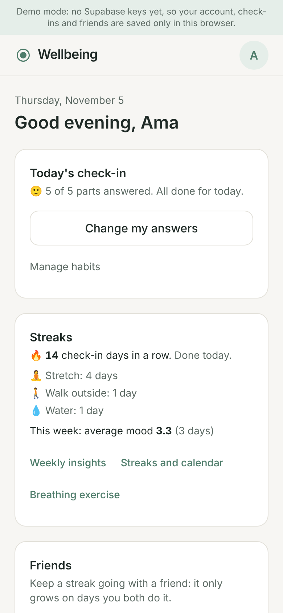
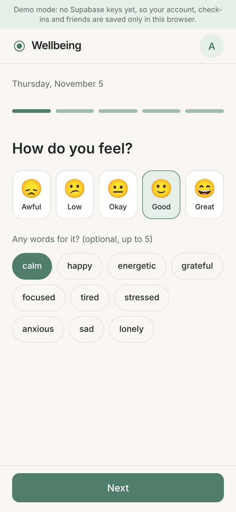
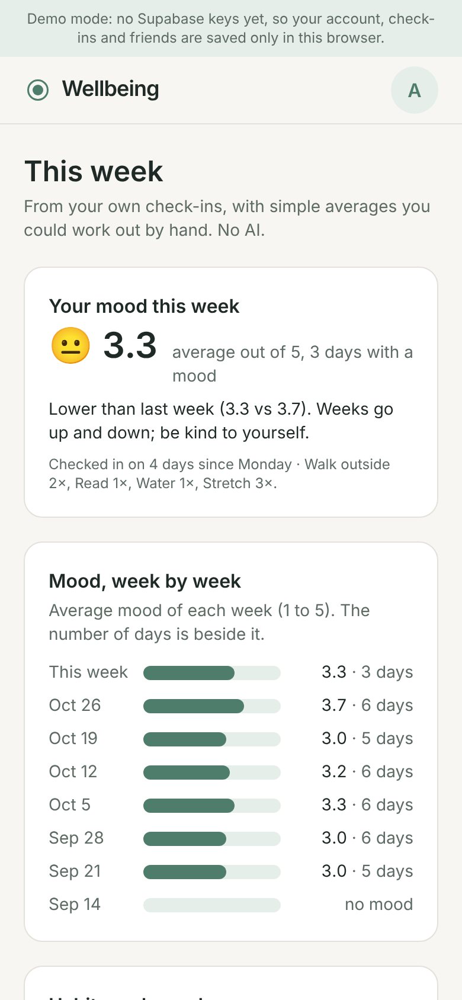
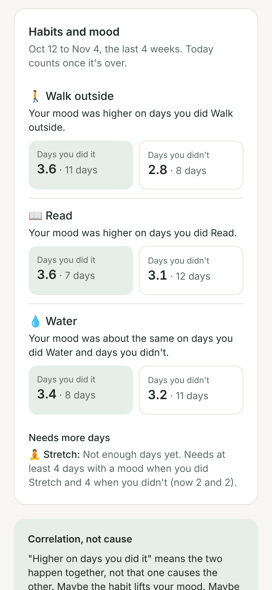

# Wellbeing

A calm, minimal daily check-in (about 5 minutes): mood, screen time, gratitude, a short journal and
habits, with per-habit streaks and shared streaks with a friend. It's a PWA: you can install it on your
phone from the browser, and it opens with no connection.

**Status:** all 5 stages done (accounts + PWA, the daily check-in, streaks + calendar + breathing,
friends + shared streaks, then insights + export + ship prep). Runs fully in **demo mode** (no keys, data
in your browser) and is ready to deploy on Vercel with Supabase (see [Deploy to Vercel](#deploy-to-vercel)).
See [PLAN.md](PLAN.md) for all stages, [LEARNING.md](LEARNING.md) for what each stage taught and
[PRIVACY.md](PRIVACY.md) for the privacy note.

## The gap
Daylio does mood, Streaks does habits, Finch is gamified, Headspace does meditation. Few combine all of
them in one quick check-in, and shared friend streaks (the Snapchat mechanic, used for good) are rare in
wellbeing apps.

## Screenshots
Taken in demo mode on a phone-sized screen, with made-up history for a demo person, Ama.

| Home | The check-in |
|---|---|
|  |  |
| **This week** | **Habits and mood** |
|  |  |

## What works now
- Sign up / log in with email and password (Google login once Supabase is set up).
- Pick a username, see your profile (`/profile`), log out.
- **The daily check-in** (`/checkin`): mood (+ optional words) → screen time → 3 gratitudes → a short
  journal → your habits, one step at a time with big buttons. Every step can be skipped, and every
  answer is saved as you go, so stopping halfway keeps what you did. One check-in per day; opening it
  again later the same day lets you change your answers.
- **Habits** (`/habits`): add a yes/no, count or minutes habit (with an optional daily goal and
  emoji), archive one (hidden from the check-in, history kept), restore it.
- The home page shows today's progress ("3 of 5 parts answered") and Start / Continue, and your
  streaks.
- **Streaks + calendar** (`/streaks`): your check-in streak and one streak per habit (current, best,
  missed days in the last 30), plus a calendar heatmap of the last 12 weeks for your mood or for one
  habit at a time.
- **Breathing** (`/breathe`): a circle that grows and shrinks for 4-7-8 (4 rounds) or box breathing
  (6 rounds), with a countdown. With "Reduce motion" turned on in your phone's settings, the circle
  stays still and the words and countdown guide you.
- **Friends** (`/friends`): add a friend by username, accept or decline requests, remove a friend.
- **Shared streaks**: pick a friend and one of your habits; they accept by picking one of theirs (or
  making a new yes/no habit with the same name). The streak only goes up on days you **both** did it.
- **The nudge**: when your friend did a shared habit today and you haven't yet, the home page and
  `/friends` say "Sam checked in for Stretch. Your turn!" (in the app only, no notifications).
- **Weekly insights** (`/insights`): your average mood this week vs last week, 8 weeks of averages, and
  for each habit the average mood on days you did it vs days you didn't (with how many days are behind
  each number). Simple averages, explained honestly (see "How insights work" below).
- **Export my data** (Profile > Your data): download everything you saved as **JSON** (a full backup)
  or **CSV** (one row per day, opens in Excel or Google Sheets). Journal included: it's yours.
- **Privacy note** (`/privacy`, and [PRIVACY.md](PRIVACY.md)): what's stored, who sees what, how to export
  and delete.
- "Today" is the date on your phone's clock, in its time zone (America/Toronto if it can't tell).
- Install it on a phone or computer (web app manifest + icons).
- Offline: the check-in, habits, streaks, insights, breathing, friends and privacy pages open without a connection (the service worker saves them in
  advance). In demo mode the check-in fully works offline. In Supabase mode, answers saved offline
  are kept on the device and sent when you're back online ("Saved on this device, will sync").
  Streaks need your history, so in Supabase mode they load once you're back online (in demo mode
  they work offline too). Friends need the internet in Supabase mode (the page says so).

## How streaks work
- A streak is the number of days in a row you did it. **Today doesn't count against you until
  midnight** (your phone's time zone, America/Toronto by default).
- **Freeze (❄):** miss **one** day between two done days and the streak goes on. The frozen day
  doesn't add to the count. You get **one freeze per 7 days**. Two missed days in a row end the
  streak. Freezes are automatic.
- A habit with a daily goal (e.g. 8 glasses) counts as done when you reach the goal. For the check-in
  streak, a day counts if you saved anything that day.
- All of this is in `lib/streaks.ts`, with tests for missed days, freezes, daylight-saving changes and
  late-night check-ins.

## How shared streaks work
- A shared streak counts the days in a row you **both** completed the habit (each on your own local
  day). It uses the exact same rules as above, on the days you both did it.
- A day only one of you did is a missed day for the pair. **Freeze:** the pair has one freeze per 7
  days (separate from your personal ones); one such day between two both-done days is covered.
- Counts are never stored: they're worked out from both people's days each time
  (`lib/friends/shared-streaks.ts`).

## How insights work
- **Only days with a mood count.** A day you checked in without picking a mood is left out, not counted
  as a bad day.
- **Weeks run Monday to Sunday**, on your phone's local dates (America/Toronto by default), like streaks.
- **This week vs last week:** each week needs a mood on at least 3 days, or the app says "not enough
  days to compare yet". A change under 0.3 (on the 1 to 5 scale) is "about the same".
- **Habits and mood:** the last 4 weeks, **without today** (it isn't over, and most people pick a mood
  before ticking habits). For each habit: average mood on days you did it vs days you didn't, counted from
  the day you added the habit. A habit with a daily goal counts as done when you reach the goal.
- **Nothing is shown until there are 4 days on each side** (done and not done). Differences under 0.3
  are "about the same".
- **Correlation, not cause.** "Higher on days you walked" doesn't mean walking caused it: maybe you only
  walk on days you already feel good. The page says so.
- All of it is in `lib/insights.ts`, with tests (`lib/insights.test.ts`). The page only loads the date and
  mood of your check-ins, never the journal.

## Export my data
Profile > Your data > **Download JSON** or **Download CSV**. The file is made in your browser (nothing is
uploaded) by `lib/export.ts` (tested in `lib/export.test.ts`):
- **JSON:** `{ app, format_version, exported_at, time_zone, account, habits, checkins, habit_entries }`,
  exactly as stored. Every `date` is a local day in `time_zone`.
- **CSV:** one row per day (`date, mood, mood_word, mood_tags, screen_time_minutes, gratitude_1..3,
  journal`, then one column per habit: `yes` or the amount, empty = not done). It starts with a UTF-8
  "BOM" so Excel shows accents and emoji correctly.
- Only your own rows. Friends and shared streaks are left out (they involve another person).
- In Supabase mode the export needs the internet (your history is on the server).

## Run it

```bash
cd apps/wellbeing-app
npm install
npm run dev        # http://localhost:3001
```

The app uses port **3001** (not 3000) on purpose: a service worker controls a whole address, so if
wellbeing-app and media-log both used `localhost:3000`, this app's service worker would also catch the
media log's pages.

### Demo mode (no setup)
With no `.env.local`, the app runs in **demo mode**: accounts, profiles, habits and check-ins are saved
only in your browser (localStorage). A strip at the top says so. Good for trying things; nothing goes
online.

### Real accounts (Supabase)
1. Create a free project at supabase.com.
2. SQL Editor > New query > paste `supabase/migrations/20261105100000_profiles.sql` > Run. Then a new
   query with `supabase/migrations/20261105110000_checkins_habits.sql` > Run (Stage 2: habits,
   checkins, habit_entries). Then `supabase/migrations/20261105120000_friends_shared_streaks.sql`
   (Stage 4: friendships, shared_streaks and the `shared_streak_days` function). Table Editor should
   show all 6 tables with "RLS enabled". (Stage 3 needs no new SQL.)
3. Copy `.env.example` to `.env.local` and fill in `NEXT_PUBLIC_SUPABASE_URL` and
   `NEXT_PUBLIC_SUPABASE_ANON_KEY` (Project Settings > API). Never the `service_role` key.
4. Authentication > URL Configuration: Site URL `http://localhost:3001`, and add
   `http://localhost:3001/onboarding` to Redirect URLs.
5. Restart `npm run dev`. The demo strip disappears.

Google login: create an OAuth client in Google Cloud Console with redirect URI
`https://<your-project>.supabase.co/auth/v1/callback`, then enable Google in Supabase >
Authentication > Sign In / Providers and paste its ID and secret.

## Test the check-in by hand (demo mode is fine)
1. `npm run dev`, open http://localhost:3001, sign up, pick a username.
2. Home > "Manage habits": add "Stretch" (Yes / no) and "Water" (A count, goal 8). Add a third and
   archive it: it moves to "Archived".
3. Home > "Start check-in". Tap a mood and a word, tap **Skip** on screen time, type one gratitude,
   type half a sentence in the journal, then tap the app name to leave.
4. The home card says "3 of 5 parts answered". Open the check-in again: your answers are filled in.
   Tap the 5th bar at the top, tick Stretch, tap + on Water three times, **Finish**.
5. DevTools > Application > Local storage > `wellbeing-app:mock-checkins`: one check-in for today
   with exactly what you entered (skipped parts are empty), and two habit entries.
6. Offline (needs `npm run build && npm start`, see below): DevTools > Network > Offline, open
   `/checkin`, change your mood: it still saves.

## Test streaks, the calendar and breathing by hand (demo mode is fine)
Streaks need several days of history. The quickest way to get some is to type it into the demo data:
1. `npm run dev`, sign up, add a habit "Stretch" (Yes / no), do today's check-in and tick Stretch.
2. Open `/streaks`: check-in streak 1 "Done today.", Stretch 1, today's square has a dark outline.
3. DevTools > Application > Local storage > `wellbeing-app:mock-checkins`. In `habitEntries`, copy
   your Stretch entry twice and change the copies' `date` to **2 and 3 days ago** (`YYYY-MM-DD`).
   Reload `/streaks`: Stretch shows 3 days, and yesterday shows ❄ in the Stretch calendar (a freeze
   covered it). The check-in streak shows 3 too.
4. Change the copy from 2 days ago to **4 days ago** and reload: now 2 days in a row are missed, so
   Stretch is back to 1, best 2 (4 and 3 days ago), and "Missed 2 days in the last 30".
5. Tap **Mood** above the calendar: days with a mood are shaded (darker = better mood). Hover or
   long-press a square to see "Nov 5: Good".
6. `/breathe`: pick 4-7-8, **Start**. "Breathe in" for 4 s while the circle grows, "Hold" for 7 s,
   "Breathe out" for 8 s while it shrinks; "Round 1 of 4 · 1:16 left" counts down. **Stop** resets it.
7. Reduced motion: DevTools > ⋮ > More tools > Rendering > "Emulate CSS media feature
   prefers-reduced-motion: reduce". Start again: the circle stays still, the words still change.

## Test friends and shared streaks by hand (demo mode is fine)
Demo mode lives in one browser, so there's a pretend friend, **Sam** (a demo account that accepts
everything and already did shared habits on most of the last 2 weeks, today included).
1. `npm run dev`, sign up, add a habit "Stretch" (Yes / no). Don't tick it today.
2. Open `/friends` (home > "Friends and shared streaks"). Tap **Add Sam, a demo friend**: Sam is in
   "Your friends".
3. Under "Start a shared streak", pick Sam and Stretch, tap **Invite**. It's active at once, and a
   "Your turn" box says "Sam (demo) checked in for Stretch. Your turn!". The home page shows it too.
4. Do your check-in and tick Stretch. Back on `/friends`: "You both did it today", 1 day together, and
   the nudge is gone.
5. Add your Stretch entry for 1 and 2 days ago (DevTools > Local storage >
   `wellbeing-app:mock-checkins`, copy your entry and change `date`, like in the streaks test above)
   and reload: 3 days together. Add copies for **3 and 4** days ago too: 4 days together, and not 5,
   because Sam missed 3 days ago. A freeze covered that day for the pair, so the streak kept going.
6. On a later day, tap **Sam checks in today** to make the nudge appear again.
7. Two real accounts: log out, sign up a second account, add the first one by username. Log back in
   as the first: the request is under "Friend requests". Accept, invite, log in as the other, pick a
   habit, Accept. To see Sam's side, log in as `sam@demo.local` / `demo-friend`.
8. Remove a friend: their shared streaks disappear too.

## Test insights and export by hand (demo mode is fine)
Insights need a few weeks of history. The quickest way is the same trick as for streaks:
1. `npm run dev`, sign up, add habits "Walk" (Yes / no) and "Water" (A count, goal 8). Do today's
   check-in: pick a mood, tick Walk.
2. Open `/insights` (home > Streaks card > "Weekly insights"): "This week" shows today's mood, "Not enough
   days to compare yet ... (this week 1, last week 0)", and under Habits and mood: "Not enough days yet ...
   (now 0 and 0)" for both habits (today isn't counted).
3. DevTools > Application > Local storage > `wellbeing-app:mock-checkins`. In `checkins`, copy your
   check-in 8 times with `date` set to 1 to 8 days ago and `mood` 5, 5, 5, 5, 2, 2, 2, 2 (and different
   `id`s). In `habitEntries`, copy your Walk entry for the 4 days with mood 5. Also set Walk's
   `created_at` in `habits` to 10 days ago. Reload `/insights`: Walk shows "Your mood was higher on days
   you did Walk", 5.0 · 4 days vs 2.0 · 4 days. Water still says "(now 0 and 0)": it was added today,
   and days before a habit existed don't count as "not done".
4. Delete one of the Walk entries and reload: 3 done days, so Walk moves to "Needs more days (now 3 and 5)".
5. If the 8 days cover this week and last week with 3+ moods each, the top card says "Higher" or "Lower
   than last week". Days without a mood (`"mood": null`) are not counted anywhere.
6. Export: `/profile` > Your data > **Download JSON**: the file has your habits, check-ins (journal
   included) and habit entries. **Download CSV** and open it in a spreadsheet: one row per day, a Walk
   and a Water column. Write a journal with a comma, quotes and a new line first: it stays in one cell.
7. Log in as a second demo account and export: none of the first account's days are in it.
8. `/privacy` opens from the profile's "Privacy" link and from the welcome page.

## Test the PWA by hand
The service worker only runs in a production build (in `npm run dev` it is switched off on purpose,
see LEARNING.md).

```bash
npm run build
npm start          # http://localhost:3001
```

1. Open http://localhost:3001 in Chrome. Sign up, pick a username.
2. DevTools (F12) > Application > Manifest: no errors, icons shown. Service workers: `sw.js` is
   "activated and is running". Cache storage: `wellbeing-pages-v1` (with `/checkin`, `/habits`,
   `/streaks`, `/breathe`, `/friends`, `/insights` and `/privacy` in it) and `wellbeing-static-v1`.
3. DevTools > Network > set "No throttling" to **Offline**. Reload: the home page still opens with
   your name. Go to `/checkin`, `/profile`, `/streaks` and `/breathe`: they work. Go to `/abc`:
   "You're offline".
4. Install: the install icon in the address bar (computer), or on a phone see the "Put it on your home
   screen" card on `/profile`. A phone needs HTTPS, so test phone install on the Vercel deploy
   (localhost is the only address allowed without HTTPS).

To start fresh: DevTools > Application > Storage > "Clear site data".

## Deploy to Vercel
Not deployed yet. Nothing to configure in code: Vercel recognises Next.js by itself (no `vercel.json`).
Do the "Real accounts (Supabase)" steps above first (all 3 migrations).

1. Push the repo to GitHub. On vercel.com (free Hobby plan, log in with GitHub): **Add New > Project**,
   import `my-apps`.
2. **Root Directory:** `apps/wellbeing-app` (the repo holds several apps). Framework: Next.js (detected).
   Leave the build and install commands as they are.
3. **Environment Variables** (Production, and Preview if you want preview links to work too):

   | Name | Value |
   |------|-------|
   | `NEXT_PUBLIC_SUPABASE_URL` | Supabase > Project Settings > API > Project URL |
   | `NEXT_PUBLIC_SUPABASE_ANON_KEY` | the anon / publishable key (never `service_role`) |

   Without them the deployed site runs in demo mode (data in each visitor's browser), which is also a fine
   public demo. `NEXT_PUBLIC_` values are copied into the browser code **at build time**: after changing
   them, redeploy (Deployments > ⋯ > Redeploy).
4. **Deploy.** You get a URL like `https://wellbeing-app-xyz.vercel.app`. Vercel serves it over **HTTPS**,
   which phones require to install a PWA and run its service worker (only `localhost` is allowed without it).
5. In Supabase, Authentication > URL Configuration: set **Site URL** to that URL and add
   `<that URL>/onboarding` to **Redirect URLs** (keep the `http://localhost:3001` ones for development).
   Without this, confirmation emails and Google login send people back to localhost.
6. Google login (optional): nothing changes in Google Cloud (its redirect URI is the Supabase one).
7. Check: open the URL, no demo strip; sign up, confirm, pick a username, do a check-in. On a phone:
   Chrome ⋮ > Install app, or Safari Share > Add to Home Screen. Then turn on airplane mode and open it.

Every push to GitHub then redeploys by itself (GitHub Actions keeps checking lint, tests and build).

## Scripts
| Command | What it does |
| --- | --- |
| `npm run dev` | Dev server on port 3001 (no service worker) |
| `npm run build` / `npm start` | Production build / run it (service worker on) |
| `npm run lint` | ESLint |
| `npm test` | Vitest: auth, profile cache, service worker rules, manifest and icons, check-in logic (dates, validation, merging, demo store, offline queue, SQL privacy rules), streaks, calendar grid, breathing timing, friends and shared streaks (rules, demo store, demo friend, SQL privacy rules), insights (weekly averages, habits and mood) and export (JSON, CSV) |
| `npm run icons` | Redraws the PNG icons (`scripts/make-icons.mjs`) |

## Folder map
- `app/`: pages (`/`, `/checkin`, `/habits`, `/streaks`, `/insights`, `/breathe`, `/friends`, `/login`,
  `/signup`, `/onboarding`, `/profile`, `/privacy`, `/offline`), the layout, the manifest (`manifest.ts`), icons and global
  styles.
- `components/`: React components (forms, nav bar, home, profile, habits, service worker
  registration, breathing). `components/checkin/`: the check-in flow, its 5 screens and the "save as
  you go" hook. `components/streaks/`: the streaks page, the heatmap and the home page's card.
  `components/friends/`: the friends page, shared streaks, and the home page's Friends card (the nudge).
  `components/insights/`: the weekly insights page. `components/ExportCard.tsx`: "Your data" (downloads).
- `lib/auth/`: accounts. One `AuthService` interface, a Supabase version and a demo (localStorage)
  version, chosen by whether the Supabase keys are set. Copied from `apps/media-log`.
- `lib/checkin/`: check-ins and habits. One `CheckinStore` interface, a Supabase version and a demo
  (localStorage) version, plus the offline queue that wraps the Supabase one. Also the pure logic:
  today's date key, validation, merging partial saves.
- `lib/streaks.ts`, `lib/calendar.ts`, `lib/breathing.ts`: the pure logic of Stage 3 (streak rules,
  heatmap grid, breathing phases), each with its test file.
- `lib/insights.ts`, `lib/export.ts`: the pure logic of Stage 5 (weekly summary, building the export
  files), each with its test file.
- `lib/friends/`: friends and shared streaks. One `FriendsStore` interface, a Supabase version and a
  demo version (plus demo friend Sam), and the pure shared-streak rules (`shared-streaks.ts`).
- `lib/pwa/`: tests for the service worker and the manifest.
- `public/sw.js`: the service worker. `public/icons/`: app icons.
- `supabase/migrations/`: SQL to create the tables, with Row Level Security.
- `docs/screenshots/`: the README pictures. `PRIVACY.md`: the privacy note.

## Privacy
The plain-language version is [PRIVACY.md](PRIVACY.md) (also in the app at `/privacy`). The technical
details:

Your check-ins (mood, screen time, gratitude and journal) are readable only by you. This is enforced
by the database's Row Level Security, not just the app: the `checkins` table has owner-only rules and
will never get a "friends can read" rule. The streaks page and calendar only ever load the date and
mood of your check-ins, never the journal or gratitude texts.

**What friends see:** your username and display name, and, only for a habit you chose to share with
them, which days you completed it. Not the amount (e.g. minutes), not your goal, nothing from your
check-in. Friends never get a "read" rule on your tables: one database function,
`shared_streak_days`, answers only "who did the shared habit on which day", and only to the two
people in that shared streak. See the notes at the top of both
`supabase/migrations/20261105110000_checkins_habits.sql` and
`supabase/migrations/20261105120000_friends_shared_streaks.sql`.

The service worker never stores personal data: only page shells, code and icons, which are the same
for everyone. In Supabase mode, two things are kept in this browser's localStorage: answers saved
while offline (deleted as soon as they reach Supabase) and your habit list (names only, so the
check-in works offline).

The insights page, like streaks, only loads the date and mood of your check-ins. The export is the one
place that loads whole check-ins (journal included), only your own, and only when you press Download.
